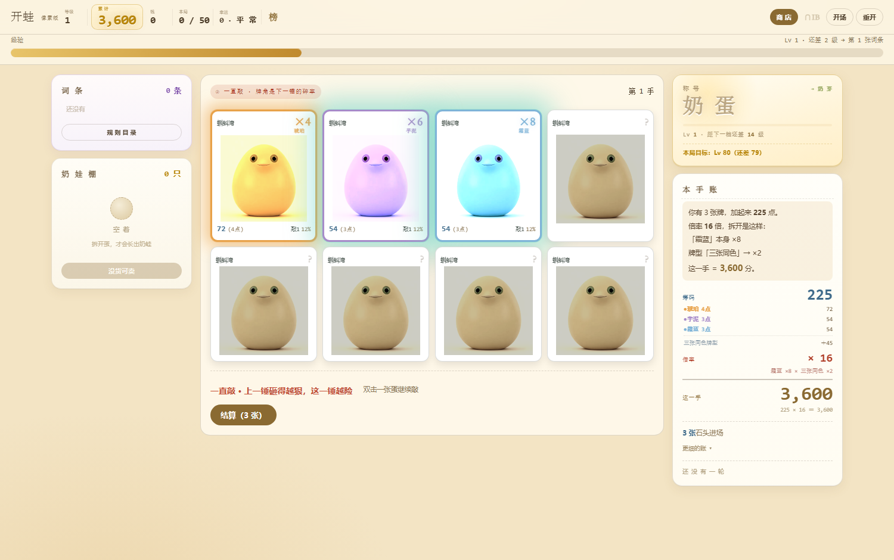
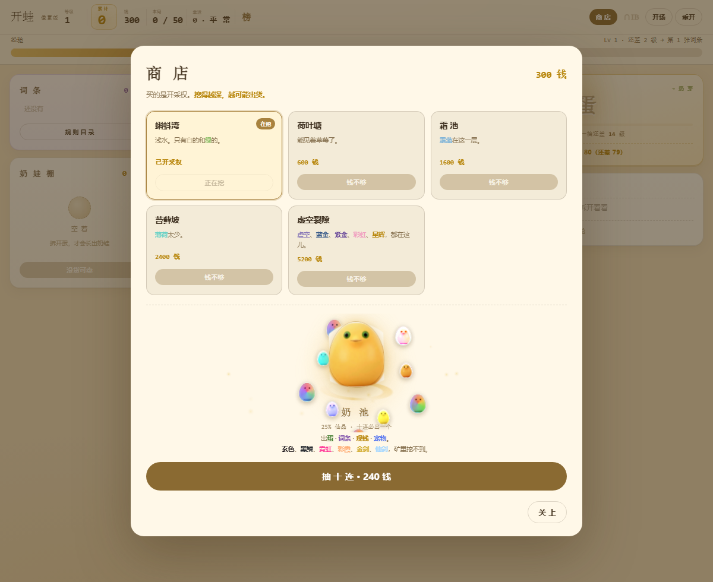
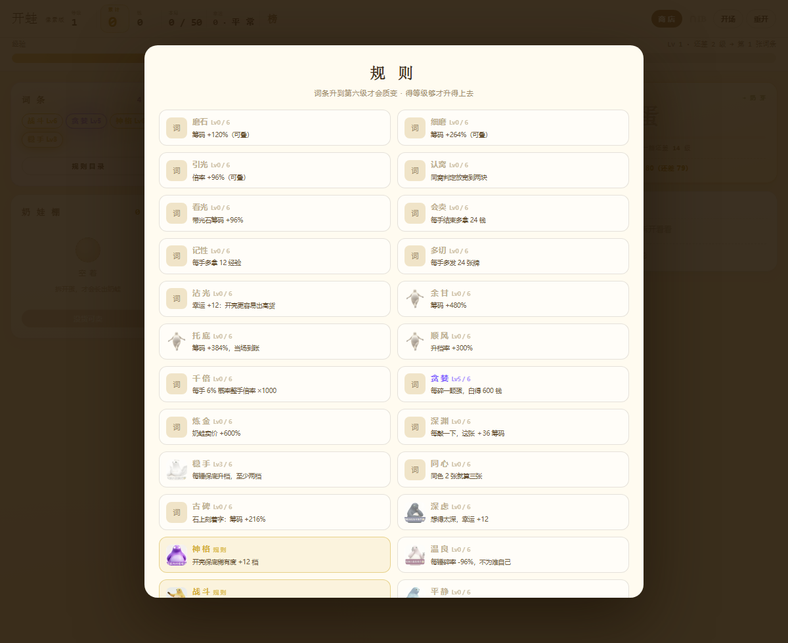

# 开蛙

一个单文件网页小游戏。双击 `index.html` 就能玩，不用装任何东西。

---

## 怎么玩

一局 50 轮，每轮发 8 张蛋。

**双击**拆开一张，露出颜色和点数。
**再双击**是敲——敲一定升档，但也可能碎。

敲到你觉得够了，点结算。50 轮打完，这一局结束。

左边是词条和奶娃棚，右边是本手账——每一手的分数怎么来的，它一行一行写着。

---

## 规则

**点数**：一张卡的底分，1~9 点。筹码 = 点数 × 18。

**稀有度**：三十档，从奶白 ×1 到仙剑 ×275。
同一颜色出现 N 张，这 N 张的倍率各乘 N。五张触发**满贯 ×3**。

**牌型**：单张 / 一对同色 / 三张同色 / 两对 / 连号 / 三张带光，各给一档加成。

**敲**：必升，没有跌。升几档看运气——

| 升几档 | 概率 |
|---|---|
| 1 | 58% |
| 2 | 25% |
| 3 | 11% |
| 4 | 4.5% |
| 6 | 1.2% |
| 10 | 0.25% |
| 15~30 | 0.05% |

**碎**：第一锤一定不碎。之后每敲一次，下一锤的碎率涨十个点。

| 敲过几次 | 下一锤碎率 |
|---|---|
| 1 | 12% |
| 2 | 22% |
| 3 | 32% |
| 4 | 42% |
| 5 | 52% |
| 6 | 62% |
| 7 | 72% |
| 8 | 82% |
| 9 以上 | 88%（封顶） |

碎了，这张就退出本手计算——一点筹码都不给。其他牌照常敲。

敲到最高一档（仙剑）就敲不动了，卡面显示「满」。

**光**：3% 的牌带彩虹框（倍率 ×3）。敲一下有 8% 变成极光（倍率 ×30），42% 会散掉。

**连击**：第 1~3 轮 ×1.1，4~6 轮 ×1.35，7~9 轮 ×1.9，第 10 轮起 ×2.6。

**词条**：每 3 级发一张，三选一。词条升到第六级会质变——效果直接翻一倍。

**矿脉**：五个开采点，越深越贵，出的货也越狠。钱从敲击掉落和抽卡台来。

---

## 三张图

| 抽卡台 | 规则目录 |
|---|---|
|  |  |

抽卡台上，一颗蛋在转，周围十颗小蛋绕着飞。外圈是仙品，内圈是渐变。

规则目录里列着每一条词条升到六级的样子。你还没拿到的那几条，图是灰的。

---

## 一些说明

**这是个单文件游戏。** 所有图片都内联成 base64，只有一个 `index.html`，3.8 MB。双击即玩，也可以直接拖进浏览器。

**概率是公开的。** 上面那两张表就是游戏里真正在跑的数值，一个数都没藏。

**设计意图**：

这游戏想说的是一句话——**敲下去一定赚，问题是你敢敲几次。**

升档是确定的，碎裂是累积的。第一锤稳稳升，第二锤只有 12% 会碎，第五锤就过半了。

碎率写在卡面右下角，按下去之前就能看见。

所以这不是运气，是判断：**这一张，还值得再冒一次险吗。**

第三锤之后，大多数人会收手。但总有那么一张牌，你已经敲到霓虹，再一下就是仙剑。

那种时候你还是会敲。

这是设计的一部分，不是漏洞。

---

## AI 使用声明

- **机制与数值**：本人设计，含模拟验证
- **美术素材**：AI 生成（ImageGen）
- **代码实现**：AI 辅助完成

---

## 版权

代码以 MIT 协议发布，随便玩、随便改。

游戏里用的蛙形象来自网络 meme「奶蛙」，非本人原创。这个形象本身有争议（它是动画《奶龙》的 AI 二创），如果你要把它用于商业用途，请自行评估风险。

**这个仓库只用于学习交流，不用于任何商业目的。**

---

## 反馈

有问题提 issue，或者直接改，PR 都收。
